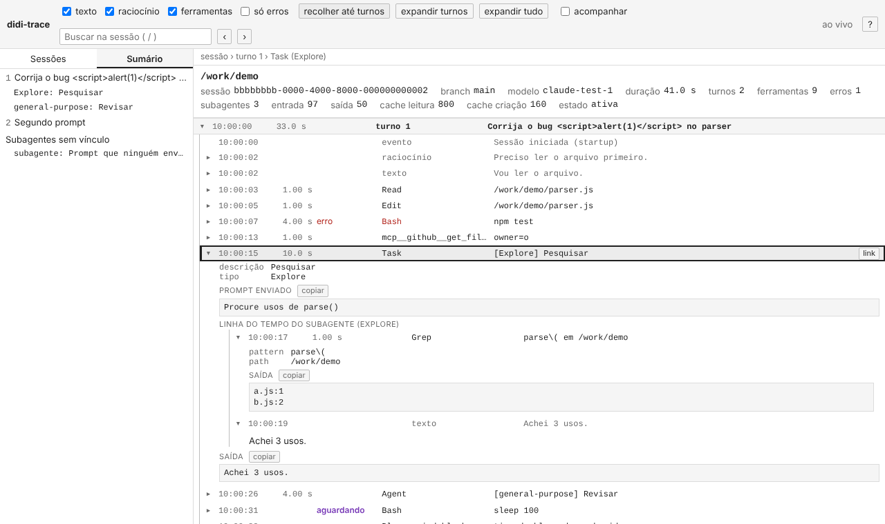

# didi-trace

Dashboard web **local** para ver, com todos os detalhes, o que o Claude Code está fazendo em cada sessão, atual ou passada. Em vez de uma linha truncada por chamada de ferramenta, você vê a entrada e a saída completas, os subagentes aninhados na chamada que os criou, o tempo de cada etapa, os tokens e os erros.



## O que mostra

- Lista de sessões agrupadas por projeto, com busca e indicador de sessão ativa.
- Linha do tempo em árvore: sessão › turno (cada prompt) › texto, raciocínio, ferramentas e subagentes, recursivamente.
- Renderização própria para `Bash`, `Edit`/`MultiEdit` (diff), `Write`, `Read`, `Grep`/`Glob`, `WebFetch`/`WebSearch`, `TodoWrite` e `Task`/`Agent`. Qualquer outra ferramenta, inclusive `mcp__*`, aparece como JSON formatado.
- Estados ao vivo: concluída, erro, em execução e aguardando permissão.
- Acompanhamento em tempo real (SSE), filtros, busca com navegação entre ocorrências, sumário lateral, trilha de localização e link direto para qualquer nó (`#<sessão>/<nó>`).
- Navegação completa por teclado (tecle `?` na página para ver os atalhos).

O dashboard funciona **só com os transcripts**, inclusive para sessões antigas. Os hooks são opcionais e deixam a tela mais rica: durações mais precisas, ferramentas em execução, pedidos de permissão, compactações e fim de sessão.

## Pré-requisitos

- Claude Code com suporte a plugins.
- Node.js 18 ou superior no `PATH`. Não há dependências npm: o que está no repositório é o que roda.

## Instalação

```
/plugin marketplace add diogenesdiniz/didi-lens
/plugin install didi-trace@didi-lens
```

Reinicie a sessão para que os hooks sejam carregados.

## Como abrir o dashboard

Digite `/didi-trace`. O comando inicia o servidor em segundo plano (se ainda não estiver rodando) e mostra a URL da sessão atual, por exemplo `http://127.0.0.1:4747/#<id-da-sessão>`. Abra-a no navegador.

Também dá para iniciar manualmente, fora do Claude Code:

```bash
node plugins/didi-trace/scripts/start-server.js
```

Para iniciar o servidor automaticamente a cada nova sessão, defina `DIDI_TRACE_AUTOSTART=1` no ambiente em que o Claude Code roda.

## Variáveis de ambiente

| Variável | Padrão | Efeito |
|---|---|---|
| `DIDI_TRACE_PORT` | `4747` | Porta do servidor (sempre em `127.0.0.1`). |
| `DIDI_TRACE_AUTOSTART` | desligado | Com valor `1`, o hook de `SessionStart` inicia o servidor em segundo plano. |
| `CLAUDE_CONFIG_DIR` | `~/.claude` | Diretório de configuração do Claude Code, onde estão os transcripts e onde o plugin grava seus dados. |

## Onde ficam os dados

- Transcripts lidos (somente leitura): `<config>/projects/<projeto>/<sessão>.jsonl` e, para subagentes, `<config>/projects/<projeto>/<sessão>/subagents/`.
- Eventos coletados pelos hooks: `<config>/didi-trace/events/<sessão>.jsonl`.
- Registro de erros do hook e do servidor: `<config>/didi-trace/errors.log` e `<config>/didi-trace/server.log`.

Os eventos podem conter entradas e saídas de ferramentas (campos acima de 1 MB são truncados). Tudo permanece na sua máquina.

## Apagar os dados coletados

```bash
rm -rf "${CLAUDE_CONFIG_DIR:-$HOME/.claude}/didi-trace"
```

Isso não afeta os transcripts do Claude Code.

## Parar o servidor

```bash
curl -s http://127.0.0.1:4747/api/health   # mostra o pid
kill <pid>
```

## Desinstalar

```
/plugin uninstall didi-trace@didi-lens
```

Depois, se quiser, apague os dados como descrito acima.

## Segurança

- O servidor escuta somente em `127.0.0.1` e recusa requisições com `Host` diferente (proteção contra DNS rebinding).
- Só lê arquivos dentro de `<config>/projects` e `<config>/didi-trace`; ids de sessão são validados e resolvidos por um índice, então caminhos arbitrários não são aceitos.
- Nenhum recurso externo: HTML, CSS e JS são servidos pelo próprio plugin, com `Content-Security-Policy` restritiva.
- Todo conteúdo do transcript é escapado antes de ir para o HTML.
- Os hooks nunca bloqueiam o Claude Code: saem sempre com código 0, sem escrever no stdout.

## Testes

```bash
npm test          # na raiz do repositório
```

Usa apenas `node:test`. O teste de fumaça no navegador é opcional: roda se o `playwright` e o Chromium já estiverem instalados e é ignorado caso contrário.

## Estrutura

```
.claude-plugin/plugin.json   manifesto
hooks/hooks.json             eventos coletados
commands/didi-trace.md       slash command /didi-trace
scripts/record-event.js      hook: grava cada evento em JSONL
scripts/start-server.js      sobe o servidor em segundo plano, de forma idempotente
server/server.js             HTTP + SSE
server/public/               interface; transcript.js (parser) é compartilhado com o servidor e os testes
test/                        testes e fixtures sintéticas
```

## Limitações conhecidas

- O front reconstrói a árvore inteira a cada lote de linhas novas (no máximo algumas vezes por segundo). Sessões de dezenas de MB funcionam, mas as atualizações ao vivo ficam mais espaçadas.
- Saídas acima de 400 mil caracteres são exibidas em parte, com um botão para mostrar tudo.
- Linhas de `attachment`, `queue-operation` e semelhantes são contadas, mas não aparecem na linha do tempo.
